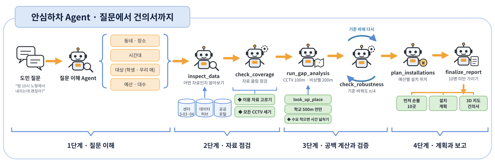
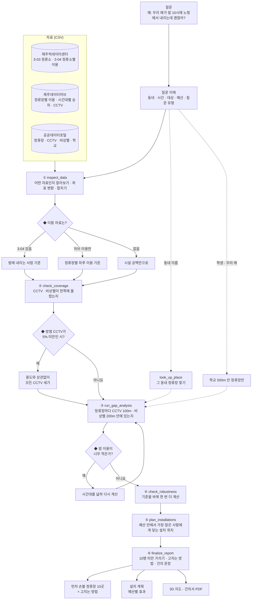

# 안심하차 Agent · 내릴 때부터 안심하자

밤에 버스에서 내려 걸어가는 사람은 많은데 주변에 **CCTV**나 **안전비상벨**이 없는 정류장을 찾아, 먼저 손볼 10곳과 고치는 방법, 예산에 맞춘 설치 계획까지 알려주는 AI Agent예요.

- 범죄 지도나 위험 지도가 아니에요. **시설이 부족한 곳**을 찾는 도구예요.
- 평소 말투로 물어보면 돼요. 예: "우리 애가 밤 10시에 노형에서 버스 내리는데 괜찮아?", "CCTV 5대를 놓는다면 어디가 좋아?"
- 결과는 늘 같은 모양으로 나와요. **먼저 손볼 정류장, 고치는 방법, 근거 숫자, 설치 계획, 건의 문장**이 나와요.

**웹 데모:** https://hosting1108.github.io/night-gap-agent/

- 설치 없이 브라우저에서 바로 써 볼 수 있어요. 센터 PC 버전과 **같은 Agent 코드**가 브라우저 안에서 돌아가요(Pyodide).
- 실제 공개 자료로 시작하고, CSV를 화면에 끌어다 놓으면 Agent가 알아보고 다시 분석해요. 올린 파일은 그 브라우저 밖으로 나가지 않아요.
- 웹 데모는 규칙 모드로 동작해요. Claude 모드는 센터 PC 버전에서 API 키를 넣으면 써요.

## 1. 설치 (센터 PC, Windows 11)

1. Python 3.10 이상을 설치해요. 설치할 때 "Add python.exe to PATH"를 체크해요.
2. 이 폴더에서 명령 프롬프트를 열고 아래 명령을 실행해요.
   ```
   pip install -r requirements.txt
   ```
   - Claude에 연결하는 데 필요한 패키지예요. 설치하지 못해도 **규칙 모드**로 모든 기능이 동작해요.
3. `config.env.example`을 `config.env`로 복사하고 `ANTHROPIC_API_KEY`를 채워요. 센터에서 키를 설정해 주는 경우에는 비워 둬요.
   - **Anthropic API 키 발급:** console.anthropic.com에 로그인 → API Keys → Create Key. 평가용 키는 사용 한도를 정해 두고, 평가가 끝나면 삭제해요.
   - **제주데이터허브 키 (자료를 새로 받을 때만):** jejudatahub.net에 로그인 → 마이페이지 → 프로젝트 관리에서 API를 신청하고 프로젝트키를 복사해 `JEJU_HUB_KEY=`에 넣어요. 제출물에는 이미 받은 자료가 들어 있어서, 분석만 할 때는 필요 없어요.
   - `config.env`는 제출물과 저장소에 넣지 않아요.

| 환경변수 | 필수 | 설명 |
|---|---|---|
| `ANTHROPIC_API_KEY` | 아니요 | Claude 모드용 키. 없으면 규칙 모드로 동작 |
| `NIGHTGAP_MODEL` | 아니요 | 쓸 Claude 모델 (기본 `claude-opus-5-5`) |
| `NIGHTGAP_EFFORT` | 아니요 | 추론 강도 (기본 `low`) |
| `NIGHTGAP_FORCE_RULES` | 아니요 | `1`이면 키가 있어도 규칙 모드로만 실행 |
| `JEJU_HUB_KEY` | 아니요 | `tools/fetch_hub_usage.py`로 허브 자료를 새로 받을 때만 |

## 2. 실행

- `run.bat`을 더블클릭하면 브라우저가 `http://127.0.0.1:8765`로 열려요.
- 이 PC 안에서만 접속돼요. 끄려면 검은 창에서 Ctrl+C를 눌러요.

## 3. 사용법

1. **자료** (화면 오른쪽 위)
   - 처음 열면 **실제 자료**로 시작해요. 공개 정류장·CCTV·비상벨·학교·시간대별 승차 자료(`data/public`)와 정류장별 이용 자료(`data/input`)가 이미 들어 있어요.
   - **내 자료 더하기**: "자료" 버튼 → "CSV 올리기"를 누르거나, CSV 파일을 화면 아무 곳에나 끌어다 놓아요. 여러 개를 한 번에 놓아도 돼요.
     - 파일 이름이 달라도 Agent가 컬럼을 보고 어떤 자료인지 알아내요. 대화창에 "무엇으로 알아봤고, 넣으면 무엇이 달라지는지"를 말해 준 뒤 기존 자료와 합쳐 **바로 다시 분석**해요.
     - 센터 3-03 버스 정류소 정보 → 이 정류장 위치를 먼저 써요.
     - 센터 3-04 버스 정류소별 이용 현황(최근 1~3개월 권장) → 밤에 내리는 사람 기준으로 순위를 매기고 막차가 이른 곳도 찾아요.
     - CCTV·비상벨 자료 → 기존 위치와 합쳐 다시 세요(같은 위치는 한 곳으로).
     - 보안등 자료 → 가로등이 닿지 않는 정류장도 찾아요. 학교 자료 → 학교 주변 정류장을 따로 봐요.
     - 어떤 자료인지 알 수 없는 파일은 분석에 넣지 않고, 어떤 컬럼이 필요한지 알려줘요.
   - 대화창에 "어떤 자료 써?", "내 자료 넣으려면?"처럼 물어도 지금 쓰는 자료와 넣는 방법을 알려줘요. 이때는 지금 결과가 그대로 남아요.
   - "가상 시연"을 누르면 가상 자료로 바뀌어요. 정류장 이름이 모두 "가상"으로 시작해요.
2. **물어보기**: 예시 버튼을 누르거나 질문을 직접 적어요.
3. **결과 보기**: 화면을 처음 열면 실제 자료로 만든 제주 전체 결과가 바로 보여요. 위쪽 메뉴에서 6개 화면을 오가요.
   - **홈**: 위에서부터 첫 화면, 한 문단 소개, 숫자 카드 6개, 이 주제를 고른 이유, Agent가 하는 일, 그리고 **Agent 작업 공간**이 이어져요.
     - 첫 화면 뒤에는 **밤의 제주 3D 지도**가 깔려 있어요. 지도를 누르거나 "지도 크게 보기"를 누르면 그 자리에서 지도가 확대되며 화면 가득 지도만 보여요. 정류장을 눌러 살펴보고, "← 처음 화면으로"나 Esc를 누르면 첫 화면으로 돌아와요. 아래 작업 공간의 지도에서는 "크게" 버튼으로 대화창을 접고 지도만 넓게 볼 수 있어요.
     - Agent 작업 공간은 **왼쪽에 대화, 오른쪽에 밤의 제주 3D 지도**가 나란히 있어요. 질문과 답이 대화처럼 쌓이고, 지도는 답에 맞춰 바로 움직여요.
     - 첫 화면의 "Agent에게 물어보기"나 숫자 카드의 버튼을 누르면 작업 공간으로 내려가요.
     - 동네(약 2km 구역)를 누르면 확대되고, 그 동네의 정류장 수, CCTV·비상벨 수, 비어 있는 정류장 목록이 나와요.
     - 끌면 이동, Shift+끌기로 회전, 휠로 확대해요. 왼쪽 위 "제주 전체"를 누르면 돌아가요.
   - **우선 개선**: 맨 위에 **Agent가 고른 1순위 정류장** 카드가 있어요.
     - 고치는 방법(CCTV 새로 달기 / 근처 CCTV 방향 돌리기 / 비상벨 달기), 걷는 시간, 비교 숫자, "왜 여기를 골랐나요", 주변 지도가 함께 나와요.
     - 아래 10곳을 누르면 정류장마다 주변 지도(CCTV는 파란색 100m, 비상벨은 초록색 200m, 학교는 보라색 원), 걸어서 몇 분인지, 건의 문장, 로드뷰 링크가 펼쳐져요.
     - 오른쪽 "결과 확인"에는 기준을 바꿔 다시 계산한 결과가 나와요. "기준 바꿔도 4/4"는 4번 모두 10위 안에 들었다는 뜻이에요.
   - **설치 계획**: 예산을 정하고 정류장마다 할 일을 골라 보는 화면이에요.
     - 정류장마다 "CCTV 그대로 / 방향 돌리기 / CCTV 새로 달기 / 비상벨 달기"를 고르면 비용과 "+N명"이 나와요. 고르지 않은 곳에는 "그대로 두면 하루 N명이…"가 나와요.
     - 위쪽에 새로 CCTV·비상벨이 닿는 사람 수, 등급(S~D), Agent 추천과 비교한 %가 바로 바뀌어요. "Agent 추천대로 채우기"를 누르면 같은 돈으로 더 많은 사람을 지키는 곳부터 채워요.
     - "설치 비용 바꾸기"로 비용을 바꿀 수 있어요. CCTV 430만원은 2024년 지자체 CCTV 설치 비용과 대수로 계산한 금액이에요.
     - 오른쪽 "몇 대를 놓으면 몇 명을 지킬까"는 CCTV(또는 비상벨)를 1~30대 달 때의 그래프예요.
   - **한눈에 보기**: 큰 숫자 4개와 꼭 알아야 할 내용 4가지예요. 카드를 누르면 자세한 화면으로 가요.
   - **Agent가 한 일**: 맨 위 **Agent 분석 흐름** 그림에 쓴 자료, 계산 순서와 걸린 시간, 중간 판단, 결과 화면이 나와요. 아래에 단계별 기록과 Agent의 설명이 있어요.
   - **건의서**: 요지, 현황, 우선 개선 표, 위치, 정류장별 건의, 설치 계획안, 기대 효과, 확인 결과, 출처를 **그림 8개**와 함께 담은 문서예요. 설치 계획 화면에서 직접 고른 계획이 있으면 그 계획이 들어가요. "인쇄 · PDF로 저장"으로 내보내요.
   - "CSV 저장", "PNG 저장"도 있어요. 모두 10명 미만 숫자를 가린 결과예요.
   - 지도의 주황 불빛은 위성으로 찍은 실제 밤 불빛(NASA Black Marble)이에요.
   - 주소 끝에 `?still=1`을 붙이면 화면 움직임이 꺼져요.

## 4. Agent가 직접 판단하는 것

| 상황 | Agent가 하는 일 |
|---|---|
| 올린 파일이 무엇인지 모름 | 열 이름과 값으로 알아내고 이유를 보여줘요 |
| 좌표가 TM(미터) 형식 | 위경도로 바꿔요 (EPSG:5174, 5181, 5186) |
| 어느 시의 CCTV가 한 용도에 몰려 있음 | 용도와 상관없이 모든 CCTV를 세도록 바꾸고 이유를 알려줘요 |
| 이용 현황(3-04)이 없음 | 제주데이터허브 정류장별 이용이 있으면 그걸로, 없으면 시설과 주변 정류장 수로 순위를 매겨요 |
| 학생·자녀 귀갓길 질문("학원", "우리 애") | 학교에서 500m 안 정류장만 골라 순위를 매기고, 가까운 학교를 근거에 적어요 |
| "CCTV 5대", "비상벨 20개" 같은 질문 | 그 대수만큼, 옆 정류장까지 가장 많은 사람을 지키는 위치를 고르고 다른 방법과 비교해요 |
| 200m 안에 CCTV가 이미 있음 | 새로 달지 않고 방향만 돌리자고 알려줘요 |
| 순위 확인 | 기준을 바꿔 다시 계산하고, 정류장마다 "기준 바꿔도 n/4"를 보여줘요 |
| 같은 위치에 CCTV가 두 번 올라와 있음 | 한 곳으로 합치고 몇 건 합쳤는지 보여줘요 (비상벨은 한곳에 여러 개가 실제로 있어서 합치지 않아요) |
| 밤에 이용하는 정류장이 적음 | 시간을 저녁 8~11시로 넓히고 타는 기록도 더해 다시 계산해요 |
| 10곳이 한 동네에 몰림 | 몰려 있다고 알리고, 동네를 정해 다시 물어보라고 안내해요 |
| 결과에 10명 미만 숫자 | "10명 미만"으로 가려요 |
| 질문 모양이 제각각 | 장소 확인("연동 정류장 안전해?"), 예산("1억이면?"), 동네 비교("어느 동네가 제일 비어 있어?"), 현황("몇 곳이야?")을 구분해 그에 맞게 답해요. "열시 반", "밤늦게", "퇴근길", "자정" 같은 시간 표현과 동네 이름(연동, 한경면, 서귀포)도 알아들어요 |
| 서비스와 관계없는 질문 | 답하기 어렵다고 말하고 무엇을 물어볼 수 있는지 안내해요 |

Agent가 하지 않는 일: 범죄 예측, 특정 장소를 "위험하다"고 단정하기, 원래 자료를 Claude에 보내기.

## 5. 동작 방식

질문 하나가 들어오면 Agent가 아래 순서로 도구를 고르고, 중간 결과를 보며 판단(◆)을 바꿔요.



<details>
<summary>판단 갈래까지 자세히 보기</summary>



</details>

- **Claude 모드**: Claude(`claude-opus-5-5`)가 결과를 보며 다음에 어떤 계산을 할지 정하고, 마지막 설명과 건의 문장을 써요. 숫자는 모두 정해진 계산식으로 구해요.
- **규칙 모드**: API 키가 없거나 인터넷이 막혀 있으면, 같은 계산을 같은 순서로 끝까지 해요.
- **Claude에 보내는 것**: 열 이름, 행 수, 집계 결과, 점수표만 보내요. 원래 자료는 보내지 않아요.
- **인터넷 접속**: `api.anthropic.com` 한 곳만 써요. 지도는 외부 지도 서비스 없이 직접 그려요.

## 6. 폴더 구조

```
app/server.py        로컬 웹 서버
app/agent.py         Agent (지시문, 도구, Claude 모드, 규칙 모드)
app/tools.py         자료 판별, 정류장 계산, 고치는 방법, 설치 위치 고르기, 반출 기준
app/geo.py           거리 계산, 좌표 변환(TM → WGS84)
app/static/          화면 (map3d.js: 외부 라이브러리 없이 만든 3D 지도)
data/sample/         가상 자료 (tools/make_synthetic.py로 다시 만들 수 있어요)
data/public/         공개 자료 (정류장, CCTV, 비상벨, 학교, 시간대별 승차)
data/input/          센터에서 올린 자료와 제주데이터허브 정류장별 이용 합계
docs/plan/           기획서 (plan_template.html → plan.html, nightgap_plan.pdf)
docs/                결과 설명서, 데이터 명세, 설계 문서, Agent 지시문(prompts.md)
pages/               웹 데모용 연결 코드 (bridge.js: 서버 대신 답하기, worker.js: 브라우저 안 파이썬 실행)
tools/               자료 수집, 통계·차트, 기획서·웹 데모 만들기(build_pages.py), 가상 자료 만들기
tests/               자동 테스트와 질문 이해 시험 (intent_cases.json)
```

## 7. 데이터 출처

| 자료 | 출처 | 쓰는 곳 |
|---|---|---|
| 3-03 버스 정류소 정보, 3-04 버스 정류소별 이용 현황 | 제주빅데이터센터 | 정류장 위치, 밤에 내리는 사람, 막차 시간 |
| 제주특별자치도_버스정류소현황 | 공공데이터포털 15010850 | 3-03이 없을 때 정류장 위치 |
| 일일 정류소별 버스 이용자 정보 | 제주데이터허브 API 613 | 3-04가 없을 때 정류장별 이용(승차+환승) |
| 일별 시간대별 버스 승차 인원 | 제주데이터허브 512 | 밤 시간대·이용자 유형 비율(제주 전체) |
| CCTV 정보 | 공공데이터포털 15013094, 제주데이터허브 846 | CCTV 위치 |
| 안전비상벨 위치 | 공공데이터포털 15028206 | 비상벨 위치 |
| 초중등학교 위치 | 공공데이터포털 15021148 | 학교 근처 정류장 |
| 밤 불빛 위성 사진 | NASA Black Marble (GIBS, CC0) | 3D 지도 배경, 정류장 밤 밝기 |

## 8. 오류와 제약사항

### 오류가 날 때

| 증상 | 이유 | 해결 |
|---|---|---|
| `python`을 찾을 수 없다고 나옴 | Python이 없거나 PATH에 없음 | Python을 다시 설치하면서 "Add python.exe to PATH"를 체크해요 |
| 오른쪽 위에 "규칙 모드"라고 나옴 (Claude면 "Claude 연결됨") | API 키 없음, `anthropic` 미설치, 인터넷 막힘 | 그대로 써도 모든 기능이 동작해요. Claude를 쓰려면 `config.env`에 키를 넣어요 |
| "버스 자료가 부족해요" | 정류장 자료(3-03 또는 공공데이터포털 정류소현황)가 없음 | 정류장 파일을 올려요 |
| 포트 8765가 이미 사용 중 | 앞에 띄운 서버가 켜져 있음 | 이전 검은 창을 닫거나 `python app\server.py --port 8766` |
| 한글이 깨짐 | 파일 글자 형식 | UTF-8과 CP949는 알아서 읽어요. 다른 형식이면 UTF-8로 저장해 올려요 |

### 제약사항

- 올릴 수 있는 파일은 CSV예요. 엑셀 파일은 "CSV UTF-8"로 저장해서 올려요.
- 좌표는 위경도(WGS84)나 한국 TM 좌표(EPSG:5174·5181·5186)를 읽어요.
- 밤에 내리는 사람과 막차 시간은 센터 3-04(정류장별 시간대 이용)를 넣었을 때 계산해요. 공개 자료만 있으면 정류장별 하루 이용으로 순위를 매겨요.
- Claude 모드는 인터넷과 API 키가 있어야 하고, 질문당 약 30초 걸려요. 없으면 규칙 모드로 1~3초 안에 같은 기능을 써요.
- 센터 PC 버전은 이 PC 안(`127.0.0.1`)에서만 접속돼요.
- 웹 데모는 규칙 모드로만 동작해요. 처음 열 때 분석 엔진(약 10MB)을 받느라 몇 초 걸리고, 올린 파일은 그 브라우저 안에서만 써요.
- 결과는 CCTV·비상벨이 닿는지를 본 **시설 공백**이에요. 범죄나 위험을 예측하지 않아요.

## 9. 더 넣을 수 있는 자료

- 가로등 위치 자료(전국보안등정보표준데이터)를 `data/public`에 넣으면 가로등까지 같이 봐요.
- 새 CCTV·비상벨 목록을 넣으면 같은 위치는 알아서 합쳐 바로 반영해요.
- 센터 3-03·3-04를 올리면 밤에 내리는 사람과 막차 시간을 기준으로 바뀌어요.
- 제주데이터허브 정류장별 이용을 직접 받으려면 `config.env`에 `JEJU_HUB_KEY=프로젝트키`를 넣고 `python tools/fetch_hub_usage.py 20251013 20251025`처럼 날짜를 정해 실행해요. 결과는 `data/input`에 생겨요.

## 10. 확인과 다시 만들기

```
python -m unittest discover tests
python tools/make_results.py
python tools/make_real_stats.py
python tools/build_plan.py
python tools/build_pages.py   # 웹 데모(site/)를 다시 만들어요
```
- 첫 줄은 자동 테스트 22개를 실행해요(질문 이해 시험 40개 포함).
- 둘째 줄은 결과 설명서의 가상 데이터 시나리오 3개를 `docs/results/`에 다시 만들어요.
- 셋째 줄은 실제 자료 통계와 차트를 다시 만들어요(위성 밝기 집계에만 Pillow를 써요).
- 넷째 줄은 기획서와 결과 설명서의 숫자를 다시 채우고 기획서 PDF를 만들어요(Chrome 필요).
